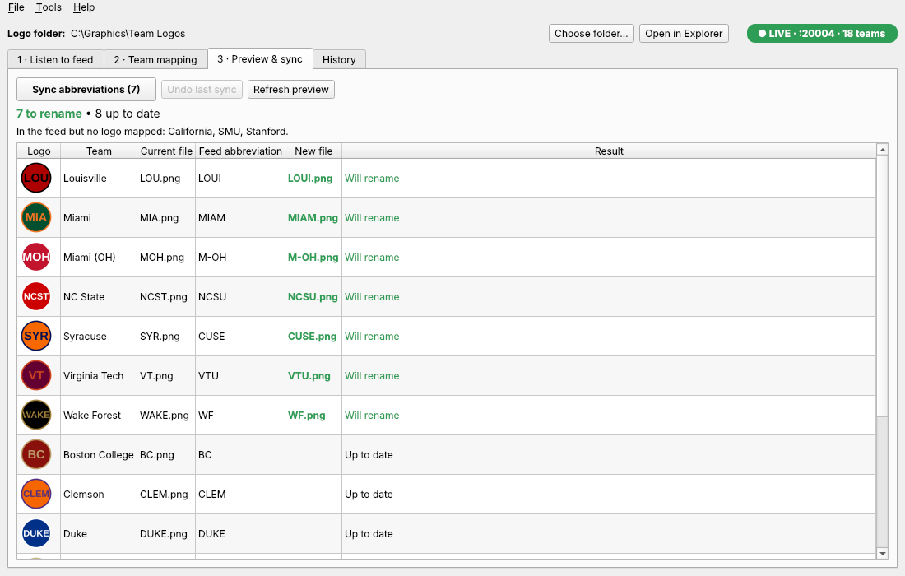

# LogoSync

A Windows app that renames team logo files to this season's abbreviations, which it receives from a UDP feed.
`MIA.png` becomes `MIAM.png` when the feed says `( Miami, MIAM )`. The image itself is never changed.



## How it works

1. **Choose your logo folder** (top of the window): the PNGs named with old abbreviations (`MIA.png`, `FSU.png`, …).
2. **1 · Listen to feed**: LogoSync listens on UDP port **20004** and lists every team and abbreviation that arrives.
3. **2 · Team mapping** (first time only): tie each logo to its team. Click **✨ Suggest matches from feed** and LogoSync
   guesses from the file names (`FSU` → **F**lorida **S**tate **U**niversity, `CLEM` → **Clem**son, `MIA` → **Mia**mi).
   Check the suggestions, fix any that are wrong, then **Save mapping**. Close calls (is `MIA.png` Miami or Miami (OH)?)
   are marked in red instead of guessed.
4. **3 · Preview & sync**: every old → new file name is shown first. Click **Sync abbreviations** to rename.

**Next season:** open LogoSync, let the feed arrive, check the preview, and click Sync. Each team keeps a permanent ID,
so the mapping is never redone. Only new teams or new logos need mapping.

Try it without the real server: **Tools → Try the demo**. It makes 15 made-up logos and sends a test feed to this PC.

## Safety

- Files are only **renamed**, never opened in an image editor or re-saved. Each file is checked with SHA-256 after the rename to prove the bytes didn't change.
- **Nothing is ever overwritten.** If the new name is already taken (by another team's logo, or any other file), that team is skipped and the reason is shown.
- Two teams with the same new abbreviation, names Windows refuses (`CON`, `NUL`, `COM1`…) and characters not allowed in file names are blocked too.
- Swaps (`A.png` ↔ `B.png`) and case-only changes (`mia.png` → `MIA.png`) work. Every file first gets a temporary name, then its final one.
- **Undo last sync** puts the names back. If the PC or app stops in the middle of a sync, it's rolled back automatically the next time the folder is opened.
- Teams that haven't arrived in the feed yet are left alone, and the sync asks first if any are missing. A partial feed can't rename what it never received.
- If a logo is renamed by hand outside LogoSync, the mapping finds and follows it by its image content.
- Only **Replace logo** / **Restore** change an image's content, and the previous image is always backed up first.

## Replacing a logo (new artwork)

New artwork for a team, without touching its mapping:

1. On **2 · Team mapping**, select the team and click **Replace logo…** (or right-click the row, or just **drag a PNG onto the row**).
2. LogoSync shows the old and new logo side by side over a checkerboard, so you can see transparency. A file that isn't a readable PNG can't be used.
   You're warned (but not stopped) if the size differs or the new one has no transparency. Nothing is ever resized or re-saved.
3. Click **Replace logo**. The file keeps its current name (e.g. `MIAM.png`) and the team keeps its ID, so the next sync works as before and the new art follows the team.

The old image is saved first in `%APPDATA%\LogoSync\logo-history\`. **Logo history…** lists every earlier version with its date and size.
**Restore selected version** brings one back, and saves the image it replaces too, so a restore can also be undone. The new file is
written under a temporary name and swapped in with one atomic step, so a failure (or a locked file) leaves the old logo in place.
The feed only ever renames files and never changes an image.

## The feed

The expected packet is `( Miami, MIAM )`. Because the exact packet layout isn't confirmed yet, LogoSync also accepts:

| Packet | Example |
|---|---|
| Several records in one packet | `(Miami, MIAM)(Clemson, CLEM)` |
| One record per line, or separated by `;` or `|` | `Miami, MIAM` ⏎ `Clemson, CLEM` |
| Parentheses or commas inside the name | `( Miami (OH), M-OH )`, `( Washington, D.C., WSH )` (split on the **last** comma) |
| JSON | `{"name": "Miami", "abbr": "MIAM"}` or a list of them |
| Abbreviation first | `( MIAM, Miami )` |

If the feed sends the same team again, the newest abbreviation wins. The **Raw packets** box shows every packet exactly as
it arrived, so if the real feed looks different, it's easy to see how.

"Listening" doesn't prove the server is sending (UDP has no connection). The feed tab shows packets received, teams received,
time of the last packet and who sent it. The badge at the top right turns green (**LIVE**) only while packets are arriving.

**Recordings:** each new team or changed abbreviation is saved to `recordings\feed-YYYY-MM-DD.log` in the data folder.
**Load feed file…** replays a recording, or any text file with one `Team Name, ABBR` per line, without the server.

**Test sender:** `python -m logosync.core.sender --host <PC address> --port 20004` sends the demo teams from another computer.
Add `--file teams.txt` to send your own list, or `--per-packet 5` to put several teams in each packet.

## Download and run

Download **LogoSync.exe** from the repo's **Releases** page, under *LogoSync for Windows (latest)*. It's one file and needs no
installation. Every push that changes `logosync/` builds it again.

- It's unsigned, so the first time Windows SmartScreen may say "Windows protected your PC". Click **More info → Run anyway**.
- The first time it listens, Windows Firewall asks for network access. Allow **Private networks**, or packets from the server can't reach it.
- If another program on the same PC already uses port 20004, tick **Share the port with other programs**.

Mapping, history, recordings and the log are kept in `%APPDATA%\LogoSync` (**Tools → Open data folder**). Use **File → Export mapping**
to back up the mapping or move it to another PC.

## Build it yourself

Needs Python 3.12 or newer on Windows:

```
cd logosync
build.bat            # installs dependencies, runs the tests, builds dist\LogoSync.exe
python -m logosync   # or just run it from source
```

Code layout: `logosync/core` has no GUI code (parser, feed, UDP listener, matcher, planner, the journaled renamer, SQLite storage).
`logosync/ui` is the PySide6 window. `tests/` covers parsing, matching, collisions, swaps, rollback, crash recovery, undo,
and a full demo run through the real window.
