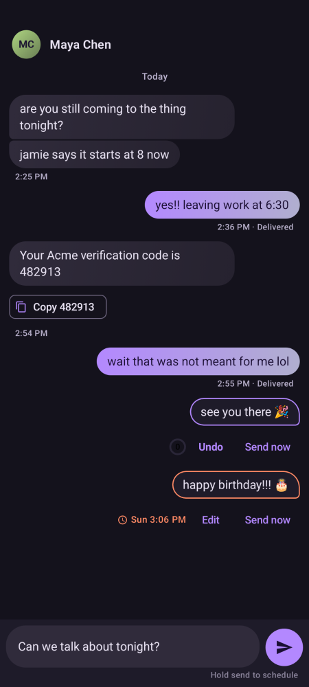
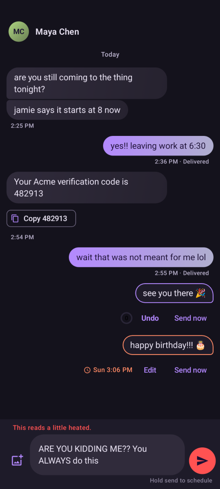
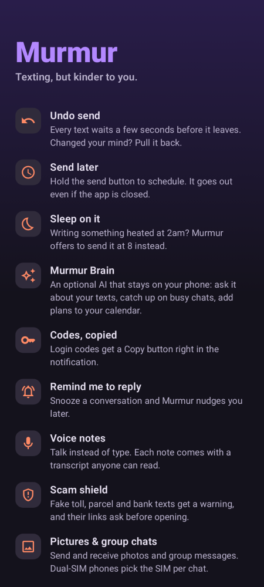

# Murmur

A texting app for Android that replaces your phone's default SMS app. It does what Messages does, plus a few things that save you from yourself.

| Conversation | Heat meter | First run |
|---|---|---|
|  |  |  |

## What's different

- **Undo send.** A sent text waits 5 seconds (or 3, or 10, or none) with a countdown ring before it really leaves. Tap **Undo** and it's back in the box.
- **Send later.** Hold the send button: in an hour, this evening, tomorrow morning, or any date and time. Scheduled texts sit in the conversation with an outline until they go. They are stored on disk and armed with an alarm, so they still go out if Murmur is closed or the phone restarts.
- **Sleep on it.** Between midnight and 5am, if what you wrote reads angry (a simple word and punctuation check on the phone), Murmur offers to send it at 8am instead. You can still edit or cancel it before then.
- **Codes, copied.** Login and verification codes get a **Copy 482913** button in the notification and on the message, and their own "Codes" filter.
- **Remind me to reply.** From a notification ("Remind me in 1h") or a conversation's menu: in 1 or 3 hours, this evening, or tomorrow morning.
- **Pictures and group chats (MMS).** Tap the picture button to send a photo. It's turned upright and shrunk to fit your carrier's size limit. Picture and group messages download automatically, and tapping a photo opens it full screen with pinch to zoom. If a download fails (MMS needs mobile data, even on Wi-Fi), the notification has a **Try again** button.
- **Group chats** go to everyone as one conversation, so replies reach the whole group. Settings can switch this to separate texts.
- **Dual SIM.** A chip above the message box picks the SIM for each conversation. Until you choose, Murmur answers on the SIM the other person last wrote to. Each message shows which SIM it used.
- **Voice notes.** Tap the mic (it shows when the message box is empty), talk, tap stop. Listen back before sending, and fix the transcript Android writes on the phone (Android 13+). The transcript goes with the note, so anyone can read it instead of listening. Notes are AMR audio, which any phone, iPhones included, can play, and about 3 minutes fit a standard MMS. When playing, tap the waveform to jump, change speed (1×, 1.5×, 2×), or raise the phone to your ear to hear it through the earpiece. Received notes without a transcript get a "Show transcript" button.
- **Scam shield.** Murmur flags texts that look like scams: links pretending to be USPS, banks or toll agencies, shortened links, bare number addresses and scam-prone domains (.top, .xyz…), "reply Y to activate the link", and urgency from strangers. Flagged texts get a red warning with the reasons, a **Block sender** button, links drawn in red that ask before opening, a "Suspicious" filter, and a "⚠ Likely scam" notification without the reply button. "It's fine" clears a false alarm. All checks run on the phone.
- **Repeating messages.** In the send-later sheet, choose Every day, Weekdays, Every week, Every month (the 31st stays the 31st, or the last day of a shorter month) or Every year, then pick the first time. Murmur sends it again on that schedule, catching up if the phone was off. A clock badge on the main screen opens a list of everything scheduled, with Send now, Stop repeating and Cancel.
- **Murmur Brain (optional).** A switch in Settings downloads Gemma 4 E2B, Google's open AI model (2.6 GB, Apache 2.0), through Android's download manager. That download is the only thing Murmur uses the internet for, and once the model is on the phone everything runs offline. It powers:
  - **The Brain tab**, a private chat next to Messages. Ask about your texts ("what's the gate code Jen sent?", "when does Jake land?") and Murmur searches them first, answers with who sent it and when, and links back to the conversation. Anything else is ordinary chat. If a question names someone you text, or mentions texting, the search always runs, whatever the model decides.
  - **Add to calendar.** A text with a plan ("dinner friday at 7 at Luigi's?") gets a chip that opens your calendar app with the title, time and place filled in. The model picks out the plan, and plain code works out the date, because small models are bad at calendar arithmetic.
  - **Catch me up.** Opening a chat with 8 or more new messages offers a three-bullet summary of what was decided, what's still open and what was asked of you. It's also in the menu of any conversation.
  - **Needs reply.** A filter, with a "Waiting on you" label, for recent conversations whose last text is waiting on you. A question mark counts even without the Brain; with it, requests like "pick up milk on the way home" count too.
  - **Scam second opinion** on texts from strangers that passed the regular checks.

  The model loads only while it works and unloads three minutes later. Settings has a speed test that measures loading, reading and writing separately and picks the processor or graphics chip, whichever writes faster.
- **Filters:** All, Needs reply, Unread, People (in your contacts), Unknown (not in your contacts), Codes, Suspicious.
- **Pins, drafts, search.** Pin conversations to the top, keep a draft per conversation, and search names and the text of every message.
- The basics: reply from the notification, mark as read, delivery reports, a counter that shows when a text will split into several, contact photos, "respond via message" when you decline a call, and dark and light themes.

Everything stays on the phone. Murmur has no servers and no account. It holds the internet permission only because Android's download manager requires it for the optional Brain model download. Messages, codes and drafts are never sent anywhere.

## Not done yet

- **RCS** (Google's chat features: typing dots, read receipts, high-res media over data). Google doesn't let other apps use it.
- **Video and contact cards.** Murmur sends photos and voice notes only. Received videos and contact cards still save to the phone, but Murmur shows only their text.
- **Your own number in group chats.** Murmur hides you from a group's member list using the number Android reports for your SIM. Some carriers don't report it, and then you may appear as a member of your own groups.

## Install on your phone

1. On your phone, open this repo's **Releases** page and pick **Murmur for Android (latest)**. That's `github.com/<owner>/<repo>/releases/tag/murmur-latest`.
2. Tap **Murmur.apk**, then open the download. Android asks you to allow installs from your browser once.
3. Open Murmur and tap **Make Murmur my messaging app**.
4. **Android 13 and newer** blocks texting apps that didn't come from the Play Store. If step 3 is refused, open Settings → Apps → Murmur, tap **⋮** (top right) → **Allow restricted settings**, then tap the button in Murmur again. The ⋮ option only appears after Android has blocked something once.

To go back to your old app, open Murmur → Settings → Default messaging app → Change. Your messages stay where they are, because every SMS app reads the same shared store on the phone.

## Build

You need JDK 17+ and the Android SDK (platform 35).

```sh
cd murmur
./gradlew assembleRelease          # → app/build/outputs/apk/release/app-release.apk
./gradlew testDebugUnitTest        # MMS codec, scam shield, repeats, Brain prompts and answer parsing, date phrases, codes, heat and segment tests
./gradlew recordPaparazziDebug     # re-render the screenshots above, no phone needed
```

Every push that touches `murmur/` builds the APK on GitHub Actions and updates the `murmur-latest` release.

APKs are signed with `app/sideload.keystore` (password `murmur`), a throwaway key committed to the repo so that each new build installs over the last one. It is not a secret. If you ever publish to the Play Store, make a real key and keep it out of git.

## Layout

- `data/`
  - `SmsRepository`: reads and writes the phone's shared SMS/MMS store and contacts.
  - `PendingStore`: texts waiting to go out, in the undo window or scheduled.
  - `Vibes`: the heat meter, code detection, segment counting and avatar colours.
  - `Sims`: dual-SIM list and your own numbers.
  - `ScamShield`: scam detection.
  - `Repeat`: rules for repeating messages.
  - `Prefs`: settings.
- `mms/`
  - `Pdu`: reads and writes the MMS wire format.
  - `Mms`: shrinks pictures, and sends, downloads and stores MMS. Android's own MMS service handles the carrier connection.
- `sms/`
  - `Outbox`: every message leaves through here. It waits, then fires on an alarm or a timer, whichever comes first. Pictures and group chats go as MMS, everything else as SMS.
  - `SmsSender`: hands a text to the radio.
  - `Receivers`: incoming SMS, MMS notices, sent and delivered reports, scheduled sends, boot, and respond-via-message.
- `brain/`
  - `Brain`: downloads, loads and runs the model through LiteRT-LM.
  - `BrainChat`: the Brain tab. It decides whether a question is about your texts, searches them, and answers.
  - `PlanTime`: turns "friday at 7" into a date.
  - `BrainPrompts`: what Murmur asks it and how the answers are read. This is plain Kotlin, so the same prompts can be tried against the model on a computer.
- `voice/Voice`: records AMR, plays with speed control and raise-to-ear, and transcribes with Android's speech recognizer.
- `notify/Notifier`: notification channels, inline reply, the Copy-code button, and reply reminders.
- `ui/`: Jetpack Compose screens: a Messages / Brain tab bar, conversations, the Brain chat and settings.

### Choosing the Brain's model

Before shipping, I ran Murmur's real prompts on a computer (LiteRT-LM's JVM build) against three open models: five angry drafts to rewrite, and eight texts to sort (four scams, four genuine). Murmur no longer rewrites drafts, but that test is what separated the models. The Brain tab's pipeline was then checked end to end on Gemma 4 E2B with ten questions: seven about a sample inbox, one whose answer isn't there, and two general ones. It got all ten right, at 3 to 5 seconds each on the desktop CPU.

| Model | Download | Rewrites | Scam check | Time per answer* |
|---|---|---|---|---|
| Qwen3 0.6B | 0.5 GB | Often answered the text instead of rewriting it | 4/8 (called nearly everything a scam) | ~2 s |
| Qwen2.5 1.5B | 1.6 GB | Mostly echoed the anger back | 6/8 | ~4 s |
| **Gemma 4 E2B** | 2.6 GB | Calm and true to the original | **8/8** | ~2 s |

\*On a 4-core desktop CPU. A phone will differ; Settings has a speed test. Gemma 4 E2B peaked at about 1.5 GB of memory.
